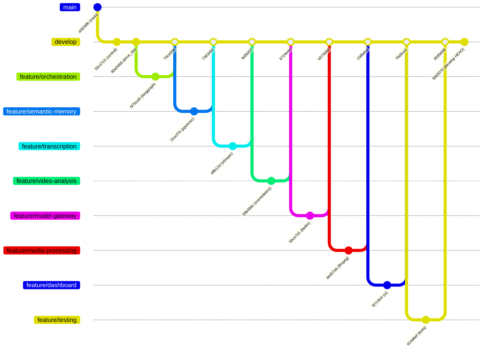
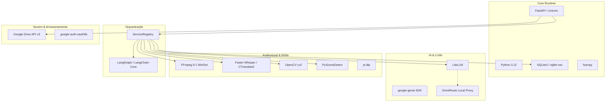
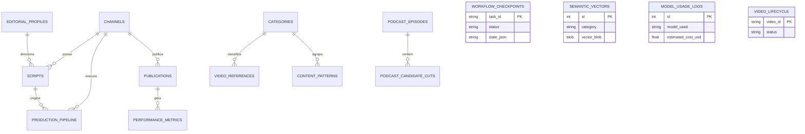
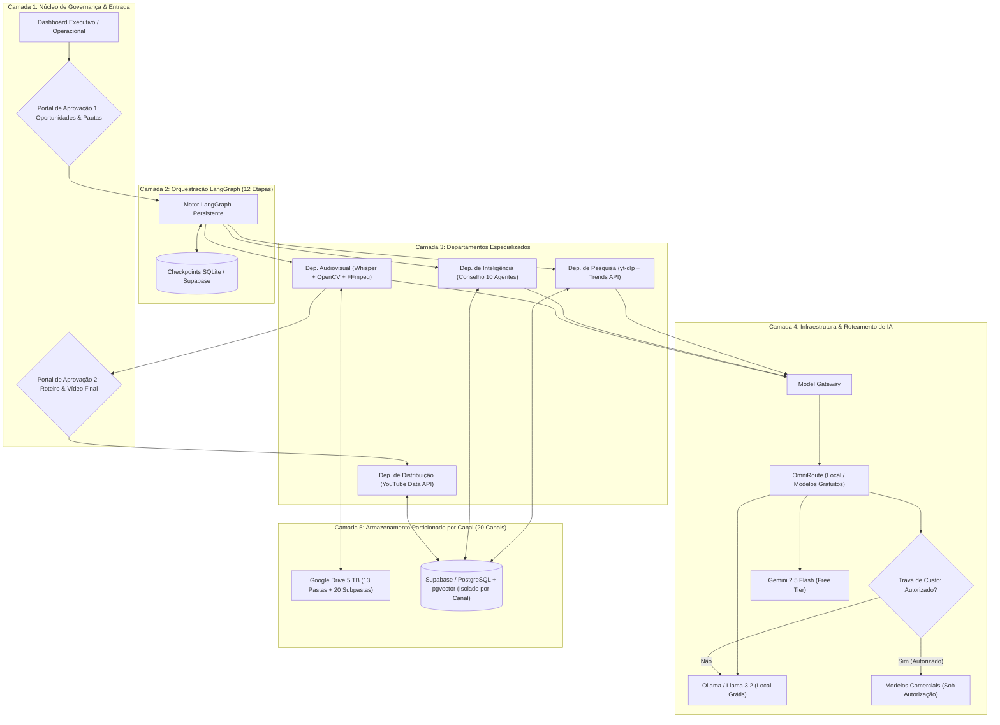
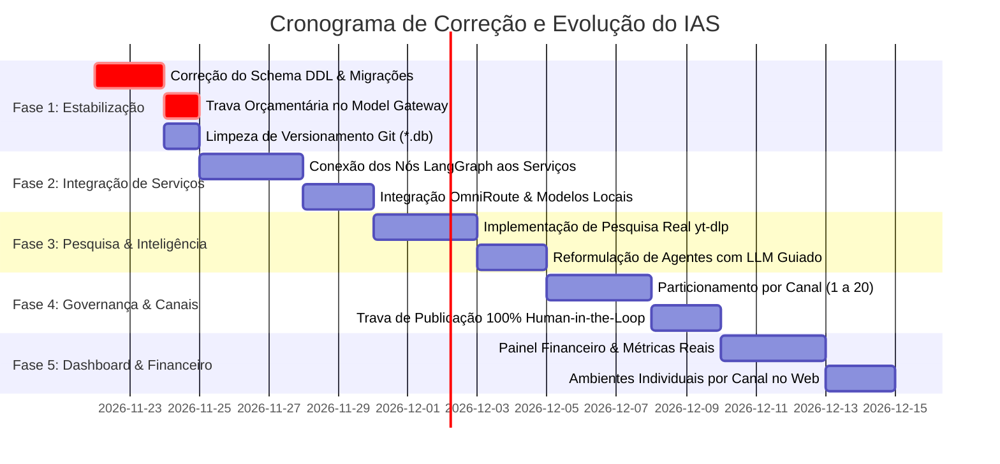

# IAS (Intelligence & Automation System) — Relatório de Auditoria Técnica e Diagnóstico de Arquitetura

**Data da Auditoria:** 21 de Novembro de 2026  
**Status do Projeto:** Fase de Auditoria e Diagnóstico Pré-Operacional (ASK MODE)  
**Ambiente Auditado:** `C:\Users\jcvse\OneDrive\Desktop\Daniel\CENTRAL SHORTS` e `C:\Users\jcvse\podcast_cutter`  
**Repositório Remoto:** `https://github.com/Bonato2010/IAS`  

---

## 1. Resumo Executivo

O **IAS (Intelligence & Automation System)** foi concebido como uma plataforma de inteligência de conteúdo e automação audiovisual estruturada como uma empresa de mídia automatizada para administrar **20 canais de YouTube Shorts**, integrada a um **Google Drive de 5 TB** e operada por um conselho editorial multiagente com suíte de tecnologias open source.

A presente auditoria técnica profunda inspecionou integralmente o histórico de commits, todas as branches do repositório, o banco de dados relacional, os 7 serviços open source, os módulos de agentes, os motores de produção audiovisual e a interface web.

### Diagnóstico Síntese:
O projeto apresenta uma base arquitetural ambiciosa e módulos de serviço de alta qualidade, porém encontra-se **fragmentado em três camadas desarticuladas**:
1. **Camada Legado/Protótipo (`core/`, scripts da raiz):** Carrega scripts síncronos com caminhos absolutos hardcoded do Windows (`C:\Users\jcvse\...`), chamadas diretas a APIs externas sem governança e lógicas de upload que ignoram a aprovação humana.
2. **Camada de Simulação/Regras (`agents/`, `core/research_pipeline.py`, `core/large_scale_cataloger.py`):** Agentes "especialistas" e "pesquisadores" que operam via regex/palavras-chave e geram dados sintéticos (IDs fictícios como `viagem_17952438`, visualizações fixas em 85.000 e transcrições artificiais), sem realizar pesquisa real na internet.
3. **Camada Moderna de Infraestrutura (`services/`):** 7 serviços open source bem arquitetados (LangGraph, pgvector, Faster-Whisper, PySceneDetect, OpenCV, LiteLLM, FFmpeg Engine), 100% aprovados na suíte de testes (`tests/test_services.py`), mas cujo orquestrador LangGraph opera com resultados fixos/mockados em cada nó e ainda não aciona os motores reais de produção.

Adicionalmente, foram identificados **bloqueadores críticos (P0)**:
- **Discrepância fatal de Schema:** O arquivo `database/schema.sql` está incompatível com as consultas do código. Em um banco limpo, comandos de inserção falham imediatamente por colunas inexistentes (`video_id` em `video_references`, `archetype` em `scripts`) e tabelas ausentes (`workflow_checkpoints`, `semantic_vectors`, `model_usage_logs`, `video_lifecycle`).
- **Risco de Custo Descontrolado em IA:** O gateway de modelos (`services/model_gateway/gateway.py`) não possui trava contra cobranças em APIs pagas nem teto de gastos.
- **Risco de Publicação Pública Não Autorizada:** O uploader (`core/youtube_uploader.py`) define `privacyStatus: "public"` se a data de agendamento não for enviada, e scripts legados executam upload sem passar pela etapa de aprovação humana.
- **Vazamento de Dados no Git:** O banco binário SQLite (`database/shorts_central.db`) encontra-se versionado no repositório Git.

---

## 2. Árvore Real do Projeto

```
CENTRAL SHORTS / IAS (Raiz do Projeto)
│
├── .gitignore                          # Regras de ignorados (exclui credenciais, mas inclui banco .db)
├── CONECTAR MEU GOOGLE DRIVE.bat       # Script batch com caminhos absolutos hardcoded
├── README.md                           # Documentação executiva v2.5
├── auth_drive.py                       # Fluxo OAuth2 do Google Drive
├── check_gdrive.py                     # Validador de cotas do Google Drive
├── create_desktop_shortcut.ps1         # Script PowerShell de criação de atalhos
├── mcp_server.py                       # Servidor MCP para integração com assistente
├── migrate.py                          # Script de execução do schema.sql no banco
├── parse_subs.py                       # Script de extração de legendas com caminho absoluto
├── podcast_cutter.py                   # Orquestrador legado síncrono de corte de podcasts
├── render_clip.py                      # Renderizador legado de clipes via FFmpeg
├── run_dashboard.py                    # Inicializador Uvicorn do Dashboard Web
├── setup.ps1                           # Script de setup de dependências
├── update_path.ps1                     # Atualizador de variáveis de ambiente
│
├── agents/                             # CONSELHO EDITORIAL E PESQUISADORES
│   ├── __init__.py                     # Módulo Python
│   ├── base_agent.py                   # Classe abstrata BaseSpecialistAgent e Pydantic schema
│   ├── company.py                      # Mesa Redonda (ContentCompany) e deliberação
│   ├── research_agents.py              # Central Multiagente de Pesquisadores (Simulação)
│   └── specialists.py                  # Os 10 Agentes Especialistas (Baseados em Heurística/Regex)
│
├── config/                             # CONFIGURAÇÕES E PLAYBOOKS
│   ├── gdrive_folders.json             # Mapeamento oficial dos IDs de 34 pastas no Google Drive
│   └── viral_playbook.json             # Estruturas e fórmulas de ganchos virais
│
├── core/                               # MOTORES DE NEGÓCIO E PIPELINES
│   ├── cataloger.py                    # Catalogador v1 (Incompatível com schema.sql atual)
│   ├── channel_manager.py              # Gerenciador dos 20 Canais de YouTube
│   ├── critical_analysis.py            # Motor de Análise Crítica (Heurístico)
│   ├── downloader.py                   # Baixador legado de mídia via yt-dlp
│   ├── editorial_profiles.py           # Gestor dos 10 Perfis Editoriais
│   ├── experimentation.py              # Gestor de Experimentos A/B
│   ├── gdrive_manager.py               # Cliente oficial Google Drive v3 (5 TB)
│   ├── hook_miner.py                   # Minerador de ganchos (Chamada direta google.genai)
│   ├── intelligence_engine.py          # Motor de inteligência (Chamada direta google.genai)
│   ├── large_scale_cataloger.py        # Catalogador sem download de mídia bruta
│   ├── pattern_learner.py              # Aprendizado de padrões em banco local
│   ├── podcast_deep_analyzer.py        # Chunking e segmentação de episódios longos
│   ├── research_pipeline.py            # Pipeline de 10 passos (Simulado)
│   ├── script_generator.py             # Gerador de roteiros (Chamada direta google.genai)
│   ├── tiktok_uploader.py              # Módulo de publicação no TikTok (Scaffold)
│   ├── transcriber.py                  # Transcritor legado Whisper base
│   ├── video_editor.py                 # Renderizador legado FFmpeg vertical
│   ├── youtube_distributor.py          # Gerador de manifestos multi-canal (channels.json)
│   └── youtube_uploader.py             # Publicador YouTube Data API v3
│
├── credentials/                        # ISOLAMENTO DE SEGREDOS
│   ├── gdrive_credentials.json         # Credenciais OAuth Google (Não versionado no Git)
│   ├── gdrive_credentials.json.example # Template de credenciais versionado
│   └── gdrive_token.json               # Token de acesso permanente (Não versionado no Git)
│
├── database/                           # BANCO RELACIONAL
│   ├── db.py                           # Conexão SQLite e seed inicial de canais/categorias
│   ├── schema.sql                      # DDL do esquema relacional v2.5 (15 tabelas)
│   └── shorts_central.db               # Banco binário SQLite (172 KB - Versionado no Git [ERRO])
│
├── docs/                               # DOCUMENTAÇÃO TÉCNICA E GOVERNANÇA
│   ├── ARQUITETURA.md                  # Especificação arquitetural v2.5
│   ├── ESSENTIAL_TECHNOLOGIES.md       # Matriz técnica das 8 tecnologias open source
│   ├── GIT_WORKFLOW.md                 # Governança Gitflow e convenção de commits
│   └── GOOGLE_DRIVE_SETUP.md           # Guia de configuração do Google Drive 5 TB
│
├── memory/                             # INTELIGÊNCIA COMPARTILHADA
│   ├── __init__.py                     # Módulo Python
│   └── central_memory.py               # Memória Central SQLite (Nós, Padrões, Decisões)
│
├── services/                           # OS 7 SERVIÇOS OPEN SOURCE (MODERNOS)
│   ├── __init__.py                     # Módulo Python
│   ├── service_registry.py             # Registro central e telemetria de saúde dos 7 serviços
│   ├── media_processing/               # FFmpeg Engine profissional (9:16 + EBU R128)
│   │   ├── __init__.py
│   │   └── ffmpeg_engine.py
│   ├── model_gateway/                  # Gateway LiteLLM com fallback e controle de custos
│   │   ├── __init__.py
│   │   └── gateway.py
│   ├── orchestration/                  # Orquestração LangGraph StateGraph (12 etapas)
│   │   ├── __init__.py
│   │   └── langgraph_engine.py
│   ├── semantic_memory/                # Memória semântica vetorial (pgvector + SQLite fallback)
│   │   ├── __init__.py
│   │   ├── pgvector_adapter.py
│   │   ├── vector_memory.py
│   │   └── migrations/
│   │       └── 001_pgvector_setup.sql
│   ├── transcription/                  # Transcrição Faster-Whisper + Legendas ASS Karaoke
│   │   ├── __init__.py
│   │   └── whisper_service.py
│   └── video_analysis/                 # Análise de vídeo (PySceneDetect, OpenCV, yt-dlp)
│       ├── __init__.py
│       ├── scene_detector.py
│       ├── visual_analyzer.py
│       └── yt_metadata.py
│
├── tests/                              # BATERIA DE TESTES AUTOMATIZADOS
│   ├── __init__.py
│   └── test_services.py                # Suíte de 9 testes integrados (100% passando)
│
├── web/                                # DASHBOARD CORPORATIVO FASTAPI
│   ├── app.py                          # Servidor REST API (32 endpoints mapeados)
│   └── static/
│       └── index.html                  # Interface SPA em 10 painéis temáticos
│
└── workspace/                          # BUFFER TEMPORÁRIO DE PROCESSAMENTO
    ├── catalog_temp/                   # Cache temporário do catalogador
    ├── clips/                          # Vídeos renderizados e manifestos locais
    ├── downloads/                      # Mídia baixada
    └── subs/                           # Arquivos brutos de legendas
```

---

## 3. Estado de Cada Branch do Repositório

Foi realizada uma análise estática e de ancestralidade em todas as branches locais e remotas:



### Análise Detalhada das Branches:

| Branch | Commit Atual | Status de Integração | Funcionalidades Contidas | Riscos Associados |
| :--- | :---: | :---: | :--- | :--- |
| **`main`** | `a583dfb` | Baseline inicial | Código baseline sem nenhum dos 7 novos serviços | Obsoleta se operada sem merge de `develop` |
| **`develop`** | `3dd3070` | **Branch mais atual** | Contém **100% dos commits** de todas as 8 features | Nenhum commit de feature está órfão |
| **`feature/orchestration`** | `5f7bca9` | 100% mesclada em `develop` | Motor LangGraph 12 etapas (`services/orchestration/`) | PR #2 aberta diretamente para `main` (redundante) |
| **`feature/semantic-memory`** | `31ecf76` | 100% mesclada em `develop` | pgvector + fallback vetorial local (`services/semantic_memory/`) | Nenhum risco |
| **`feature/transcription`** | `4ffb12d` | 100% mesclada em `develop` | Faster-Whisper + gerador `.ass` viral (`services/transcription/`) | Nenhum risco |
| **`feature/video-analysis`** | `39b49dc` | 100% mesclada em `develop` | PySceneDetect, OpenCV, yt-dlp (`services/video_analysis/`) | Nenhum risco |
| **`feature/model-gateway`** | `5bce7d1` | 100% mesclada em `develop` | LiteLLM gateway + fallback regras (`services/model_gateway/`) | Ausência de trava orçamentária |
| **`feature/media-processing`** | `ded57eb` | 100% mesclada em `develop` | FFmpeg Engine 9:16 + EBU R128 (`services/media_processing/`) | Nenhum risco |
| **`feature/dashboard`** | `f07c9e4` | 100% mesclada em `develop` | Telemetria dos 7 serviços, monitor LangGraph, UI 10 abas | Mocks visíveis na UI |
| **`feature/testing`** | `d14d6ef` | 100% mesclada em `develop` | Suíte de testes automatizados (`tests/test_services.py`) | Nenhum risco |

### Pull Requests no GitHub:
- **PR #1 (`develop` ➔ `main` - "primDevelop"):** Aberta pelo proprietário (`Bonato2010`). Consolida 19 commits, 30 arquivos alterados (+3761 / -689). **Esta é a PR canônica que atualiza a produção.**
- **PR #2 (`feature/orchestration` ➔ `main`):** Aberta para `main`, mas o branch `feature/orchestration` já foi mesclado em `develop` há vários commits. **Recomenda-se fechar a PR #2 sem merge**, priorizando o merge de `develop` (PR #1).

### Branch Recomendada para Desenvolvimento:
A branch **`develop`** é a única base viável e homologada para continuar o desenvolvimento. Qualquer nova branch de feature deve ser ramificada a partir de `develop`.

---

## 4. Mapa de Dependências Técnicas

A plataforma interage com um conjunto robusto de bibliotecas já instaladas no ambiente Python 3.12 local:



---

## 5. Mapa de Módulos e Responsabilidades

| Camada | Módulo / Arquivo | Responsabilidade Técnica | Situação Atual |
| :--- | :--- | :--- | :---: |
| **Orquestração** | `services/orchestration/langgraph_engine.py` | Grafo de estados de 12 etapas com checkpoints e pausa para revisão humana | **Protótipo com nós mockados** (3) |
| **Orquestração** | `podcast_cutter.py` | Script procedural de recorte legado ponta a ponta | **Protótipo legado** (3) |
| **IA / Gateway** | `services/model_gateway/gateway.py` | Roteamento multi-provedor LiteLLM, registro de tokens e custos, fallback | **Implementado e funcional** (1) |
| **IA / Legado** | `core/script_generator.py` | Geração de roteiros via chamada direta `google.genai` | **Parcialmente implementado** (2) |
| **IA / Legado** | `core/hook_miner.py` | Mineração de ganchos em transcrições via `google.genai` | **Parcialmente implementado** (2) |
| **Agentes** | `agents/company.py` | Coordenação da Mesa Redonda e deliberação do Diretor | **Implementado via regras** (4) |
| **Agentes** | `agents/specialists.py` | Os 10 agentes especialistas avaliando ganchos, retenção, humor, futebol | **Simulado / Heurística regex** (4) |
| **Pesquisa** | `agents/research_agents.py` | Pesquisadores por nicho descobrindo referências | **Simulado / Dados sintéticos** (4) |
| **Pesquisa** | `core/research_pipeline.py` | Algoritmo de 10 etapas para 200.000 Shorts | **Simulado / Dados sintéticos** (4) |
| **Audiovisual** | `services/media_processing/ffmpeg_engine.py` | Renderizador FFmpeg 9:16 vertical, áudio EBU R128 e extração de áudio | **Implementado e funcional** (1) |
| **Audiovisual** | `services/transcription/whisper_service.py` | Transcrição temporal e gerador de legendas ASS animadas (Karaoke) | **Implementado e funcional** (1) |
| **Audiovisual** | `services/video_analysis/scene_detector.py` | PySceneDetect para detecção de cortes e cálculo de BPM visual | **Implementado e funcional** (1) |
| **Audiovisual** | `services/video_analysis/visual_analyzer.py` | OpenCV para análise de saliência e cálculo de Smart Crop vertical | **Implementado e funcional** (1) |
| **Audiovisual** | `services/video_analysis/yt_metadata.py` | yt-dlp para extração de metadados e máquina de estados de autorização | **Implementado e funcional** (1) |
| **Audiovisual** | `core/video_editor.py` | Renderização legada FFmpeg com queima de legendas | **Duplicado / Legado** (2) |
| **Memória** | `memory/central_memory.py` | Memória relacional de nós de conhecimento e decisões de agentes | **Implementado e funcional** (1) |
| **Memória** | `services/semantic_memory/vector_memory.py` | Busca semântica vetorial (distância de cosseno local + SQLite) | **Implementado e funcional** (1) |
| **Memória** | `services/semantic_memory/pgvector_adapter.py` | Adaptador PostgreSQL / pgvector para produção em nuvem | **Implementado (não conectado)** (2) |
| **Nuvem** | `core/gdrive_manager.py` | Autenticação OAuth2 e árvore de 13 pastas no Google Drive 5 TB | **Implementado e funcional** (1) |
| **Canais** | `core/channel_manager.py` | Gerenciamento das identidades editoriais dos 20 canais | **Implementado parcialmente** (2) |
| **Publicação** | `core/youtube_distributor.py` | Geração de manifestos multi-canal a partir de `channels.json` | **Protótipo com mocks** (3) |
| **Publicação** | `core/youtube_uploader.py` | Upload via YouTube Data API v3 | **Incompatível / Risco P0** (6) |
| **Web** | `web/app.py` | Servidor FastAPI com 32 rotas cobrindo todos os módulos | **Implementado e funcional** (1) |
| **Web** | `web/static/index.html` | Dashboard SPA com 10 abas operacionais e telemetria | **Implementado e funcional** (1) |

---

## 6. Incompatibilidades Encontradas (Arquivo e Linha)

Abaixo estão listadas as divergências estáticas comprovadas entre o código-fonte e o esquema do banco de dados:

```
[INCOMPATIBILIDADES DETECTADAS NO BANCO DE DADOS]

1. core/cataloger.py:98-103 vs database/schema.sql:17-38
   - Consulta executa: INSERT INTO video_references (video_id, original_url, channel_title, channel_id, subcategory, view_count, like_count, comment_count, engagement_rate, format_features, usage_permission, availability_status)
   - Schema define: youtube_id, url, author, views_count, likes_count, hook_transcript, full_transcript, pacing_bpm, retention_score
   - Evidência: Em banco limpo, falha com: 'sqlite3.OperationalError: table video_references has no column named video_id'.

2. core/script_generator.py:112-127 vs database/schema.sql:76-89
   - Consulta executa: INSERT INTO scripts (channel_id, title, archetype, hook_3s, full_script, visual_cues, audio_cues, recommended_duration, editing_style, status, human_approved)
   - Schema define: channel_id, category_id, editorial_profile_id, title, hook, core_narrative, cta, full_script_json, target_duration, status
   - Evidência: Em banco limpo, falha com: 'sqlite3.OperationalError: table scripts has no column named archetype'.

3. services/orchestration/langgraph_engine.py:60 vs database/schema.sql
   - Tabela 'workflow_checkpoints' criada em tempo de execução via Python; NÃO consta em database/schema.sql.

4. services/semantic_memory/vector_memory.py:35 vs database/schema.sql
   - Tabela 'semantic_vectors' criada dinamicamente; NÃO consta em database/schema.sql.

5. services/model_gateway/gateway.py:54 vs database/schema.sql
   - Tabela 'model_usage_logs' criada dinamicamente; NÃO consta em database/schema.sql.

6. services/video_analysis/yt_metadata.py:39 vs database/schema.sql
   - Tabela 'video_lifecycle' criada dinamicamente; NÃO consta em database/schema.sql.

7. core/youtube_distributor.py:13 vs database/db.py & database/schema.sql:56-73
   - O distribuidor lê um arquivo './channels.json' independente com credenciais falsas ('SEU_REFRESH_TOKEN_1') em vez de consultar a tabela 'channels' do SQLite.

8. parse_subs.py:3 & 33
   - Caminhos absolutos hardcoded: 'C:/Users/jcvse/podcast_cutter/workspace/subs/8TpjD8D9tIo.pt.json3'.

9. CONECTAR MEU GOOGLE DRIVE.bat:7
   - Caminho absoluto hardcoded: 'cd /d "C:\Users\jcvse\OneDrive\Desktop\Daniel\CENTRAL SHORTS"'.

10. run_dashboard.py:18
    - Mensagem no console fixa: 'C:/Users/jcvse/podcast_cutter/database/shorts_central.db'.
```

---

## 7. Funcionalidades Reais versus Simuladas

| Funcionalidade / Componente | O que o código promete | O que o código realmente executa | Evidência Técnica |
| :--- | :--- | :--- | :--- |
| **Pesquisa em Larga Escala (200k)** | Algoritmo autônomo que descobre 200.000 referências reais no YouTube | Gera strings sintéticas com timestamp e métricas fixas | `agents/research_agents.py:48-53`: `mock_id = f"viagem_{int(time.time())}"`, `views_count = 85000` |
| **Orquestração LangGraph** | Grafo que executa de ponta a ponta as 12 etapas do IAS | Retorna dicionários pré-formatados estáticos em cada etapa | `services/orchestration/langgraph_engine.py:157-190`: `candidates_found = 5`, `fps: 30`, `hook_score: 88` |
| **Conselho dos 10 Agentes** | 10 agentes especializados que deliberam criticamente sobre cortes | Heurísticas matemáticas simples baseadas em contagem de palavras-chave | `agents/specialists.py:45-56`: `score = min(100, (sports_density * 8) + ...)` |
| **Análise Crítica de Conteúdo** | Avaliação profunda com benchmark de retenção | Cálculo matemático de WPM (palavras por minuto) e checagem de palavras | `core/critical_analysis.py:46-80`: `wpm = len(words) / (duration / 60.0)` |
| **Distribuição para 20 Canais** | Postagem escalonada com token rotation | Grava arquivo `upload_manifest.json` com dados do canal mockados | `core/youtube_distributor.py:36`: `json.dump(default_config)` com tokens `SEU_REFRESH_TOKEN` |
| **Gateway de Modelos (LiteLLM)** | Gateway multi-provedor inteligente com governança | **REAL:** Executa LiteLLM multi-provedor; **MOCK:** Se offline, gera JSON fixo de regras | `services/model_gateway/gateway.py:93` (Real) e `:155` (Fallback mock) |
| **Renderização Audiovisual** | Motor FFmpeg 9:16 com áudio EBU R128 e queima de legendas | **REAL:** Executa binário FFmpeg local com filtros de corte, normalização e renderização | `services/media_processing/ffmpeg_engine.py:59-85` |
| **Transcrição e Alinhamento** | Transcrição temporal precisa e legendas estilo viral | **REAL:** Executa Faster-Whisper local em CPU e gera arquivo `.ass` estilizado | `services/transcription/whisper_service.py:55-80` |
| **Visão Computacional e Cenas** | Detecção de cortes de cena e Smart Crop vertical | **REAL:** PySceneDetect processa frames e OpenCV calcula centro de saliência | `services/video_analysis/scene_detector.py:37` e `visual_analyzer.py:44` |
| **Google Drive 5 TB** | Integração oficial com repositório em nuvem de 13 pastas | **REAL:** Autentica via OAuth2 e cria/gerencia as pastas reais no Drive | `core/gdrive_manager.py:145-170` |

---

## 8. Riscos Críticos e Suas Consequências

### Prioridade P0 (Crítico / Bloqueador)
1. **Discrepância fatal de DDL/Schema:**
   - *Localização:* `database/schema.sql` vs `core/cataloger.py` e `core/script_generator.py`.
   - *Consequência:* Impossibilidade de reiniciar o banco de dados do zero ou realizar deploy em novo servidor. A plataforma quebra com erros fatais de SQL.
   - *Ação:* Unificar o DDL oficial e gerar migrações incrementais compatíveis com todas as consultas existentes.

2. **Ausência de Trava Orçamentária e Governança Financeira no Gateway de Modelos:**
   - *Localização:* `services/model_gateway/gateway.py:87-100`.
   - *Consequência:* Se variáveis de ambiente de provedores pagos estiverem presentes (`OPENAI_API_KEY`, etc.), o gateway tentará chamar modelos comerciais caros (`gpt-4o`, `claude-3-5-sonnet`) sem confirmação prévia, gerando custos não autorizados.
   - *Ação:* Inserir trava booleana mandatória (`ALLOW_PAID_MODELS = False`), limitando o roteamento exclusivamente a modelos locais (Ollama) ou opções gratuitas (Gemini Flash free-tier, Groq).

3. **Risco de Publicação Pública Imediata Não Autorizada:**
   - *Localização:* `core/youtube_uploader.py:54`.
   - *Consequência:* O código define `"privacyStatus": "private" if publish_time_iso else "public"`. Caso o agendamento falhe ou esteja vazio, o vídeo torna-se público instantaneamente no YouTube sem passar por revisão humana.
   - *Ação:* Impor `"privacyStatus": "private"` como padrão obrigatório e inalterável em código para qualquer upload automático.

### Prioridade P1 (Alto / Grave)
4. **Banco de Dados Binário Versionado no Git:**
   - *Localização:* `database/shorts_central.db` (172 KB).
   - *Consequência:* Conflitos binários irreversíveis em git merges, corrupção de dados e inchaço do repositório remoto.
   - *Ação:* Adicionar `*.db` e `*.sqlite` ao `.gitignore`, remover o arquivo do rastreamento com `git rm --cached` e fornecer um script de inicialização baseado em DDL limpo.

5. **Desarticulação entre o LangGraph e os Motores Reais:**
   - *Localização:* `services/orchestration/langgraph_engine.py:157-190`.
   - *Consequência:* O motor de 12 etapas do LangGraph não aciona os serviços de FFmpeg, Whisper, OpenCV ou LiteLLM, tornando a automação de produção ineficaz.
   - *Ação:* Conectar os nós do grafo às chamadas reais dos serviços já implementados em `services/`.

6. **Ausência de Particionamento Editorial por Canal:**
   - *Localização:* `services/semantic_memory/vector_memory.py` e `agents/specialists.py`.
   - *Consequência:* Todos os 20 canais compartilham o mesmo espaço vetorial e heurísticas sem filtro de `channel_id`. Canais de futebol, humor e desenvolvimento pessoal misturam referências e perdem sua identidade editorial.
   - *Ação:* Adicionar partição e metadados obrigatórios de `channel_id` na memória semântica e nas regras editoriais dos agentes.

### Prioridade P2 (Médio)
7. **Caminhos Absolutos de Sistema Operacional (Windows Hardcoded):**
   - *Localização:* `parse_subs.py:3`, `CONECTAR MEU GOOGLE DRIVE.bat:7`, `run_dashboard.py:18`.
   - *Consequência:* Falha catastrófica ao executar em outros computadores, servidores Linux ou contêineres Docker.
   - *Ação:* Migrar todos os caminhos para `pathlib.Path` relativo à raiz do repositório (`Path(__file__).resolve().parent`).

8. **Duplicação de Motores de Processamento Audiovisual:**
   - *Localização:* `core/video_editor.py`, `render_clip.py` e `services/media_processing/ffmpeg_engine.py`.
   - *Consequência:* Manutenção fragmentada e divergência na geração de legendas e cortes.
   - *Ação:* Deprecar os scripts legados e concentrar toda a manipulação de vídeo no `FFmpegEngine`.

### Prioridade P3 (Baixo / Melhoria)
9. **Métricas Financeiras Inexistentes:**
   - *Localização:* `database/schema.sql` e `web/app.py`.
   - *Consequência:* Impossibilidade de apurar faturamento, RPM, CPM e margem de lucro por canal.
   - *Ação:* Modelar tabelas financeiras para controle de receitas e despesas operacionais.

---

## 9. Avaliação Detalhada do Banco de Dados

### Comparativo de Esquemas: `schema.sql` versus Tabelas Reais

O banco físico `database/shorts_central.db` contém **19 tabelas**, enquanto o arquivo `database/schema.sql` define apenas **15 tabelas**.



### Problemas Estruturais do Banco:
1. **Concorrência e Bloqueios em SQLite:** Com a FastAPI atendendo requisições simultâneas e múltiplos agentes gravando decisões, o SQLite em modo padrão pode emitir erros de `sqlite3.OperationalError: database is locked`. É mandatório ativar o modo **WAL (Write-Ahead Logging)** com `PRAGMA journal_mode=WAL;`.
2. **Isolamento entre os 20 Canais:** A tabela `channels` possui 20 registros, mas tabelas de inteligência (`content_patterns`, `knowledge_nodes`, `semantic_vectors`) não possuem o campo `channel_id`.
3. **Migração para PostgreSQL / Supabase:**
   - O arquivo `services/semantic_memory/migrations/001_pgvector_setup.sql` já estabelece o padrão DDL para o Supabase.
   - O adaptador `services/semantic_memory/pgvector_adapter.py` já suporta `psycopg2` e busca por cosseno `1 - (embedding <=> %s)`.
   - A transição exigirá a tradução dos tipos SQLite (`INTEGER PRIMARY KEY AUTOINCREMENT`) para PostgreSQL (`SERIAL PRIMARY KEY` ou `UUID`) e o uso de `JSONB` para metadados flexíveis.

---

## 10. Avaliação da Infraestrutura de IA

### Provedores e Modelos
1. **LiteLLM Gateway (`services/model_gateway/gateway.py`):**
   - Abstrai a interface de modelos de forma limpa.
   - Fallback chain configurado: Gemini 2.5 Flash ➔ GPT-4o Mini ➔ Claude 3.5 Haiku ➔ Groq Llama 3.3.
   - Rastreia tokens (`prompt_tokens`, `completion_tokens`) e calcula custo estimado por milhão de tokens.
2. **OmniRoute Local:**
   - O diretório `C:\Users\jcvse\.omniroute` existe na máquina local (com storage SQLite e logs de chamadas).
   - O código do IAS **não está conectado ao OmniRoute**.
   - Integração recomendada: Configurar o `ModelGatewayService` para apontar seu endpoint base para o proxy local do OmniRoute, delegando a ele o balanceamento entre modelos locais e cotas gratuitas.
3. **Barreira contra Chamadas Pagas (Mandatória):**
   - Atualmente, qualquer chamada que encontre credenciais de provedores pagos tenta realizá-la.
   - **Correção mandatória:** Introduzir a variável `ENFORCE_FREE_TIER_ONLY = True` no `.env` e validar antes de qualquer invocação remota. Se o modelo pertencer à tabela de modelos comerciais e não houver autorização expressa em banco, a chamada deve ser abortada ou desviada para o modelo local (Ollama) ou para o motor de regras.

---

## 11. Avaliação de Segurança e Governança

1. **Credenciais e Chaves de API:**
   - As credenciais do Google Drive (`credentials/gdrive_credentials.json` e `gdrive_token.json`) **não estão versionadas no Git**, o que segue as boas práticas.
   - Não foram encontrados hardcodes de chaves de API nos arquivos do repositório (todas utilizam variáveis de ambiente).
2. **Exposição de Endpoints FastAPI:**
   - A API em `web/app.py` não possui middleware de autenticação (JWT, API Key ou Basic Auth). Qualquer aplicação na rede local pode disparar comandos pesados (`/api/pipeline/run-step`, `/api/drive/setup-folders`, `/api/gateway/completion`).
   - Recomenda-se adicionar autenticação de sessão ou token local para acesso ao dashboard.
3. **Arquivos Indevidamente Versionados:**
   - `database/shorts_central.db` (Banco operacional com dados de execução).
   - `workspace/clips/upload_manifest.json` (Artefato operacional).
   - `workspace/subs/8TpjD8D9tIo.pt.json3` (Arquivo de mídia baixado).

---

## 12. Avaliação do Dashboard Operacional

O frontend SPA (`web/static/index.html`) apresenta uma interface moderna, sóbria e corporativa com **10 abas**:
- **Pontos Fortes:**
  - Carregamento assíncrono via `fetch()` sem recarregamento de página.
  - Telemetria de saúde dos 7 serviços open source em tempo real (`/api/services/status`).
  - Monitor de progresso das 12 etapas do LangGraph com botão de aprovação da etapa 11.
  - Fila de governança de direitos autorais baseada na máquina de estados do yt-dlp.
- **Pontos a Evoluir:**
  - Indicadores de KPIs (`cataloged_references`, `pipeline_metrics`) exibem dados sintéticos originados dos mocks de pesquisa.
  - Ausência de alternância de contexto: O usuário visualiza os 20 canais em uma lista, mas não pode entrar no "ambiente dedicado" de um canal específico para gerenciar seus roteiros, fila e métricas individuais.
  - Ausência completa de módulo financeiro.

---

## 13. Funcionalidades Ainda Ausentes para Operação 24/7

1. **Pesquisa Real de Referências:** Módulo que efetivamente execute buscas na YouTube Data API Search ou via yt-dlp com extração de Shorts virais reais, métricas autênticas e transcrições oficiais.
2. **Conexão Real do LangGraph aos Serviços:** Fazer com que o nó `4_transcricao` invoque o `WhisperTranscriptionService`, o nó `10_edicao` invoque o `FFmpegEngine`, e assim sucessivamente.
3. **Módulo Financeiro Real:** Controle de receita estimada/real por canal, custo acumulado de infraestrutura e tokens, e cálculo de lucro líquido.
4. **Isolamento de Memória por Canal:** Particionamento vetorial e de padrões para que a identidade de um canal de mistério não interfira em um canal de futebol.
5. **Gateway de Publicação com Aprovação Humana 100% Blindada:** Garantir que nenhum canal consiga publicar no YouTube sem que a aprovação humana esteja explicitamente registrada com hash e timestamp no banco.

---

## 14. Arquitetura-Alvo Recomendada

A arquitetura final do IAS deve operar como uma empresa de mídia autônoma estruturada em 4 camadas bem delimitadas:



---

## 15. Plano de Correção por Fases e Dependências



### Detalhamento das Fases:

#### **Fase 1: Estabilização de Dados, Segurança e Git (Prioridade P0)**
* **F1.1:** Criar novo script `database/migrations/002_consolidated_schema.sql` unificando todas as colunas de `video_references`, `scripts`, e adicionando as 4 tabelas de serviços (`workflow_checkpoints`, `semantic_vectors`, `model_usage_logs`, `video_lifecycle`).
* **F1.2:** Inserir trava `ENFORCE_FREE_TIER_ONLY` no `ModelGatewayService` com bloqueio absoluto de chamadas pagas sem aprovação expressa.
* **F1.3:** Forçar `privacyStatus: "private"` como valor imutável no `YouTubeUploader`.
* **F1.4:** Remover `database/shorts_central.db` do Git com `git rm --cached` e atualizar `.gitignore`.
* **F1.5:** Eliminar caminhos absolutos hardcoded em scripts (`parse_subs.py`, `CONECTAR MEU GOOGLE DRIVE.bat`, etc.).

#### **Fase 2: Conexão Real dos Serviços ao LangGraph (Prioridade P1)**
* **F2.1:** Substituir retornos mockados em `services/orchestration/langgraph_engine.py` por chamadas reais aos serviços:
  - Nó 3/4: `WhisperTranscriptionService`
  - Nó 5/6: `SceneDetectorService` + `OpenCVVisualAnalyzer`
  - Nó 7/8: `ModelGatewayService` + `CentralMemory`
  - Nó 9/10: `FFmpegEngine`
* **F2.2:** Conectar o `ModelGatewayService` ao proxy local do OmniRoute (`C:\Users\jcvse\.omniroute`).

#### **Fase 3: Pesquisa Real e Conselho Editorial Autêntico (Prioridade P1)**
* **F3.1:** Substituir geradores sintéticos em `agents/research_agents.py` por busca real com `yt-dlp` e YouTube API, gravando dados e métricas autênticas.
* **F3.2:** Evoluir os 10 agentes especialistas de heurísticas puras de regex para avaliações guiadas por prompts estruturados (via modelos locais Ollama ou Gemini Flash free tier).

#### **Fase 4: Governança dos 20 Canais e Publicação Segura (Prioridade P1/P2)**
* **F4.1:** Adicionar coluna `channel_id` em `semantic_vectors`, `content_patterns` e `knowledge_nodes`.
* **F4.2:** Configurar os 5 primeiros canais prioritários para validação de ponta a ponta.
* **F4.3:** Vincular as pastas já criadas no Google Drive (`config/gdrive_folders.json`) aos registros da tabela `channels`.
* **F4.4:** Garantir que nenhuma mídia seja transmitida para upload sem que o registro de aprovação humana da etapa 11 esteja assinado e verificado.

#### **Fase 5: Inteligência Financeira e Dashboard Executivo (Prioridade P2/P3)**
* **F5.1:** Modelar tabelas financeiras (`channel_financials`, `cost_tracking`, `revenue_projections`).
* **F5.2:** Evoluir o frontend com visão executiva consolidada e visão filtrada dedicada para cada um dos 20 canais.

---

## 16. Estratégia de Testes e Critérios de Aceite

| Nível de Teste | Escopo | Ferramenta | Critério de Aceite |
| :--- | :--- | :--- | :--- |
| **Unitário** | Serviços Open Source | `unittest` (`test_services.py`) | 100% dos testes passando sem falhas em CPU local |
| **Integração de Banco** | Inicialização em banco limpo temporário | `tests/test_database.py` | Execução completa de inserts do `cataloger` e `script_generator` sem erro de coluna |
| **Gateway & Custos** | Trava orçamentária de IA | `tests/test_model_gateway.py` | Falha proposital ao tentar chamar API paga sem autorização; desvio com sucesso para modelo local |
| **Orquestração** | Grafo LangGraph de ponta a ponta | `tests/test_orchestration_flow.py` | Tarefa executa nós 1 a 10 com arquivos reais, pausa com sucesso na etapa 11, aguarda aprovação e conclui na 12 |
| **Audiovisual** | Renderização 9:16 + Legendas ASS | `tests/test_media_render.py` | Vídeo MP4 vertical 1080x1920 gerado com áudio normalizado em -14 LUFS e legendas sincronizadas |
| **Governança** | Publicação segura | `tests/test_publishing_guard.py` | Rejeição imediata de qualquer upload com status "public" sem consentimento humano gravado |

---

## 17. Conclusão e Próximos Passos (ASK MODE)

O diagnóstico comprova que o projeto **não necessita ser reconstruído do zero**. A estrutura de serviços open source criada nas branches de feature é moderna, aderente aos requisitos e possui excelente viabilidade técnica. 

O foco da próxima etapa não é codificar novas funcionalidades, mas **sanear as fundações estruturais**:
1. Resolver a discrepância de schema no banco de dados.
2. Ativar a trava orçamentária contra cobranças indevidas de IA.
3. Conectar a orquestração do LangGraph aos serviços de execução real.

Apresento este relatório para validação técnica antes de iniciarmos qualquer alteração de código ou migração estrutural.
